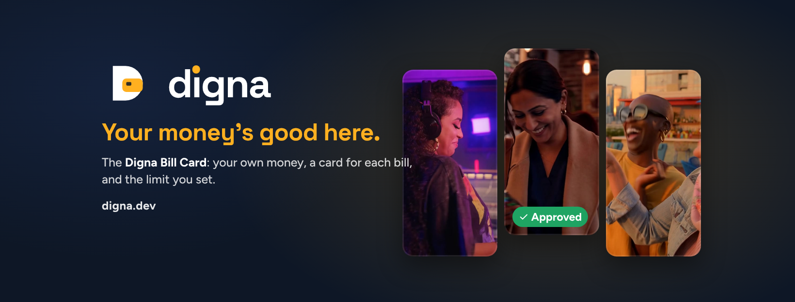
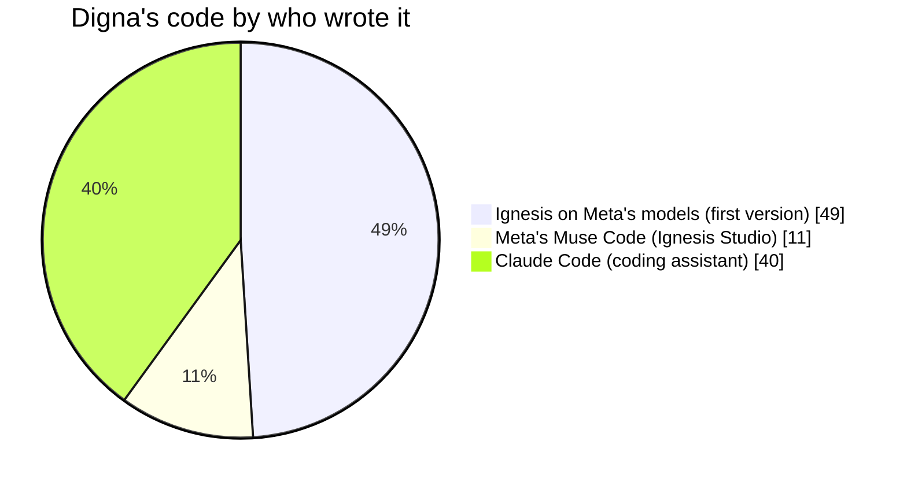

# Digna

**Your money's good here.**

**Live:** [digna.dev](https://digna.dev) · **Watch:** the 3-minute film plays on the [home page](https://digna.dev) · Built solo for the **Meta Global AI Developer Hackathon** (startup track) · Practice money only

**Try it in 30 seconds:** open [digna.dev](https://digna.dev) and tap **Look around first**. A sample account opens with no sign-up, ready to make a card, pay a bill and see a decline explained.

---

## Why Digna exists

I was trying to set up billing for Google Cloud so I could build my own product. My prepaid card was declined. Then my debit card. Again and again. The money was there; the service just didn't take the kind of cards I had, and nobody could tell me why.

That happens every day to people who pay with Cash App, Chime, debit and prepaid cards. Cloud services, hotels and car rentals turn those cards away, usually without a reason, sometimes in public. It isn't about whether the money is there. It's about which cards a place trusts.

**The Digna Bill Card is a card for one bill**: the hotel, the rental car, the cloud bill. It pays from your own money in your Digna wallet, can never spend past the limit you set, and stops on its end date. No credit check, no debt. Before you pay, Digna tells you whether a place will take it and why, and if a place ever says no, exactly what to do next.

| | Whose money | The catch |
| --- | --- | --- |
| Credit card | Borrowed | Credit check, interest, debt |
| Debit card | Your whole bank account | Often refused for holds and deposits |
| Prepaid card | Loaded onto that card | Often refused outright; leftover money gets stuck |
| **Digna Bill Card** | **Your own money, kept in your wallet** | **One card per bill, your limit, it stops when you're done** |

## Why Digna is different

Most money apps stop at holding your money. Digna is built for the moment that matters: when you're at the counter.

| Most money apps | Digna |
| --- | --- |
| One card for everything | A card for each place, each with its own limit |
| "Declined." Nothing else. | Every no comes with the reason, and what to do next |
| Bills are yours to keep track of | Snap a bill and Digna reads it and sets up its card |
| Help means waiting on hold | Ask Digna anything, in your own words, any time |
| One leaked card number puts everything at risk | Close one card; the rest keep working |

*Built from a billing page that kept saying no, for everyone who's ever felt that moment, and for a future where your money is welcome everywhere.*

## What people tell us (live)

Everyone trying Digna can answer a few quick questions: on the home page (has a card been declined when you had the money, and where), and right after a practice payment (how easy it was, whether the reason was clear, how it felt). This chart updates itself from those answers. It shows **counts only, never anyone's notes, names or emails**.

*Anyone trying the practice version can answer, so this isn't a scientific sample, and early answers include the founder's own test runs. Answer yourself at [digna.dev](https://digna.dev).*

## What you can do today

Everything below works on [digna.dev](https://digna.dev) with a free account (or a sample account, no sign-up needed). It all uses **practice money**: no real money moves, and the site says so on every page.

- **Make an account.** Start with $250 in practice money. Your password goes straight to the sign-in service, which keeps only a scrambled version of it, and only you can see your cards, bills and history.
- **Make a card for each place,** each with its own limit and end date. Pause it, raise its limit, or close it in one tap. It can never spend past its limit.
- **Pay a bill.** Upload a bill or invoice (a screenshot, a photo, a PDF or a Word file). Meta's Muse Spark reads who it's from, the amount and the due date, and keeps it in Your bills. Make a card just for it, then pay it at its own checkout.
- **See what a checkout really says.** Sample businesses follow real-world rules: a cloud service that takes credit cards only, a hotel that turns away prepaid cards for its check-in hold. Pay with an everyday card, then with a Digna card, and see each answer and why.
- **The Digna moment.** Every payment ends with its own short scene: an approval has a chime, a burst of light and "Your money's good here." A decline is soft and private: no buzzer, no red, just the reason.
- **Ask Digna.** A money assistant one tap away on every screen, which explains any decline using your own cards and payments. Type, or tap the mic and just say it. Ask it to "raise my hotel card to $180" and it sets that up for you to Confirm; nothing changes until you do.
- **Receipts** for every approved payment, as PDFs.

## Meta's AI inside Digna

Digna uses Meta's models only, through Meta's Model API.

| Model | What it does in Digna |
| --- | --- |
| **Muse Spark** | The money assistant, which can also change a card for you after you press Confirm; and reading bills and invoices (photos as pictures; PDFs and Word files as their words) |
| **Muse Image** | Every picture on the site. The people in them are invented, drawn to show many backgrounds, ages and abilities |
| **SAM 3.1** | Finding the bill in a messy photo before Muse Spark reads it: the photo is cut to the bill it outlines |
| **Muse Voice Transcribe** | Talking to Digna: tap the mic in Ask Digna, and what you say is written into the message box for you to check |

## Where to look in the code

| Folder | What's inside |
| --- | --- |
| `app/` | The Next.js app: the page, app icons, the offline helper and the server routes below |
| `app/api/ai` | Muse Spark: the money assistant, bill reading and Confirm actions |
| `app/api/find-bill` | SAM 3.1: finds the bill inside a photo |
| `app/api/voice` | Muse Voice Transcribe: push-to-talk |
| `app/api/picture/[name]` | Muse Image: the site's pictures, cached for a day |
| `app/api/_lib` | Shared server helpers: sign-in checks, the Meta key, daily AI limits, and reading SAM 3.1's bill outlines |
| `src/modules/ui` | Every screen and component; `lib/sandbox.ts` holds each sample business's card rules |
| `src/modules/database/migrations` | Tables, row-level security and the money functions, as re-runnable SQL files |
| `src/modules/security` | Input checks for every form and request (amounts, dates, IDs, redirects) |
| `src/modules/learning` | The short explainer cards inside the app |

The folders follow departments (UI, database, security, learning) because Digna was first generated by an AI build team in which each worker writes only inside its own department's folder.

## How it's built

- **App:** Next.js 16 and React 19, hosted on Northflank at digna.dev.
- **Accounts and data:** Supabase (Postgres, Auth and private file storage). Every table has row-level security: people only ever read their own rows.
- **Money stays the server's job.** Balances, limits and payments change only inside database functions (`checkout_pay`, `pay_bill`, `sandbox_pay`), which check the card, its expiry and code, the place's rules, the card's limit and the wallet. A bill can be marked paid only by a payment that went through.
- **AI calls stay on the server.** The Meta key lives only in the host's settings (`META_API_KEY`). Each person has a daily limit of AI answers, and so does the whole site, to keep costs predictable.
- **Files in the browser.** PDFs and Word files are read in the browser with its own tools (no extra packages), then only their words are sent to Muse Spark. Uploaded bills are stored in each person's own private folder.
- **Sound with no files.** The Digna chime is made by the browser itself, plays only after you press Pay, and can be turned off.

## What makes it work

How a payment moves through Digna:

1. **Prefunded wallet.** Every card is backed by money already set aside: no credit pull, no interest, no debt.
2. **Cards issued on demand.** Virtual cards, one number per place, each with its own limit and end date.
3. **Built around the card's BIN.** Hotels and rental counters read a card's first digits to decide credit, debit or prepaid; Digna's cards are designed for that moment.
4. **Real-time authorization.** Limit, end date, security code and wallet are checked server-side, inside the database, before a place gets its yes.
5. **Declines, decoded.** Bank response codes and each place's rules become a clear answer, with Meta's Muse Spark explaining what to do next.

Today every step runs on practice money, end to end. Real cards will be issued through a licensed card partner.

## Run it yourself

1. `npm install`
2. Create a Supabase project and run the files in `src/modules/database/migrations/` in order (`0001` to `0020`) in its SQL Editor. Each file is safe to run more than once.
3. Set these on your host or in `.env.local`: `NEXT_PUBLIC_SUPABASE_URL`, `NEXT_PUBLIC_SUPABASE_ANON_KEY` and `META_API_KEY` (Meta's Model API key; `MUSE_SPARK_API_KEY` can override it for Muse Spark). Optional daily site limits: `AI_SITE_DAILY_LIMIT`, `FIND_BILL_SITE_DAILY_LIMIT`, `VOICE_SITE_DAILY_LIMIT`.
4. `npm run dev`

## Honest notes

- **Practice money only.** Digna is not a bank and doesn't issue real cards yet. Real cards would come through a licensed card partner; the site will say so clearly when that's true.
- **The sample businesses and deals are invented** examples, labelled as such.
- **Built during the hackathon.** Every commit in this repository is from Oct 30 to Nov 4, 2026.

## How Digna was built

Digna was built in **Ignesis**, my AI studio: you describe an app in plain words, a team of AI agents plans it, and Meta's models write the code, with every change checked before it reaches you. I decided every feature, reviewed every change and merged it.

**Who wrote the code in Digna today** (every line of `src/` and `app/`, counted with `git blame` on Nov 5, 2026):

| Who | Share | What they built |
|---|---|---|
| **Ignesis on Meta's models** | **49%** | Oct 30: the whole first version (wallet, cards, limits, dashboard, sign-in, database, screens), one file per AI worker. Muse Wonder planned it; Muse Spark wrote it. |
| **Meta's Muse Code** | **11%** | Nov 1–2: 12 changes from the Ignesis Studio, each planned and reviewed by the Lead, built by Muse Code, checked, then merged: [#4](../../pull/4) [#5](../../pull/5) [#6](../../pull/6) [#7](../../pull/7) [#8](../../pull/8) [#10](../../pull/10) [#11](../../pull/11) [#12](../../pull/12) [#13](../../pull/13) [#14](../../pull/14) [#16](../../pull/16) [#27](../../pull/27) (Muse Spark hookup, Pay a bill, receipts, the new look, the green Paid stamp and more). |
| **Anthropic's Claude Code** | **40%** | My coding assistant for the rest: the real-feel checkout, the voice, Confirm and SAM 3.1 features, phone layout, security fixes, the survey and the owner dashboard. Its commits are marked "Co-Authored-By: Claude". |

**Inside Digna, every AI feature runs only on Meta's models:** Muse Spark (the assistant, bill reading and Confirm actions), SAM 3.1 (finding the bill in a photo), Muse Voice Transcribe (the mic) and Muse Image (every picture on the site).

**Disclosure:** Ignesis itself is a separate project I started before the hackathon (Oct 8, 2026). Its Meta model routing and the Studio that built the Paid stamp were built during the event. Ignesis isn't part of this repository. More on it soon.

## Why it matters for partners

**Digna** serves a large group card companies often turn away: people paid onto prepaid cards, Cash App, PayPal and everyday debit cards. They have the money, but hotels, car rentals and online services decline them at the counter.

- **For card and payment partners:** a ready-made product and audience for prefunded virtual cards. Every card is backed by money already set aside, so there's no credit risk and no debt.
- **For hotels, rentals and online services:** guests and customers they'd otherwise lose at checkout, paying with cards that can't overspend.
- **For banks and fintechs:** a plain-words layer that explains every decline and fixes it in one step, with Meta's AI doing the explaining.

**Ignesis** is the studio behind it: describe an app in plain words and Meta's models plan, build, check and ship it. Digna is its first real app, and the same studio can build for partners.

